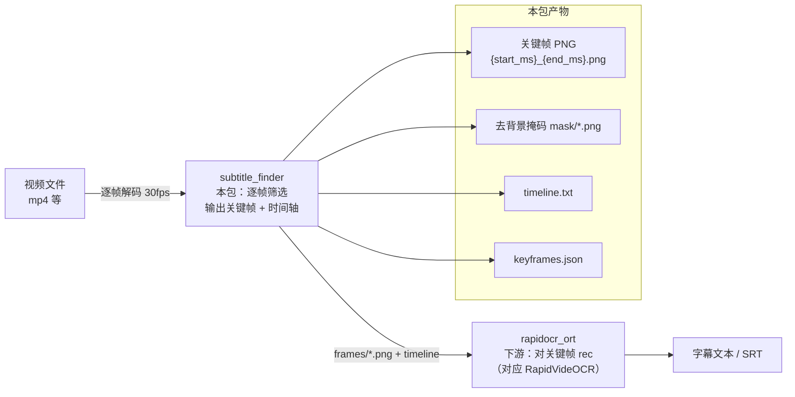
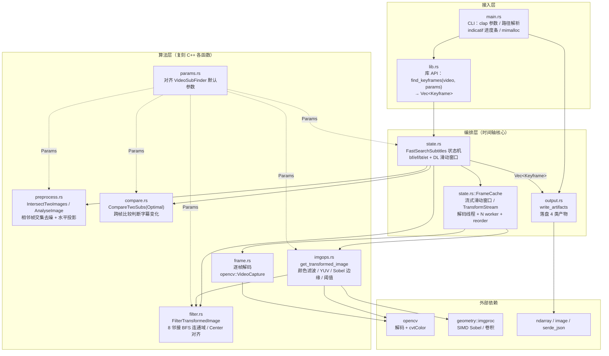
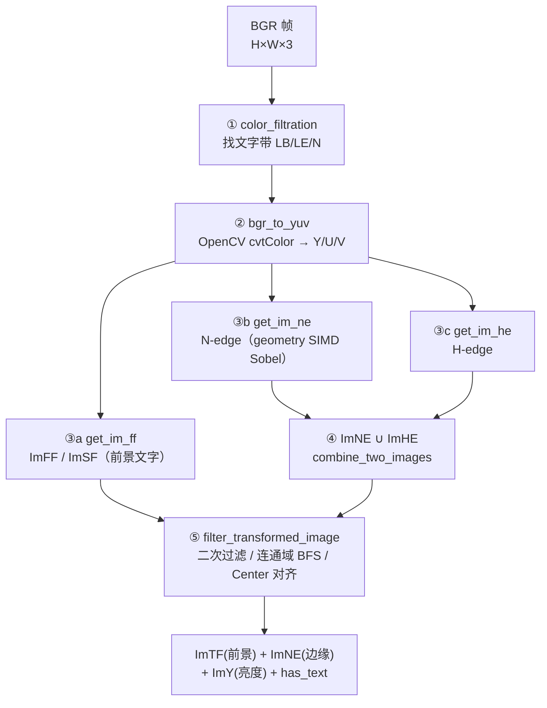
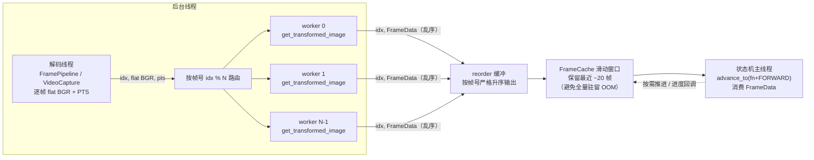
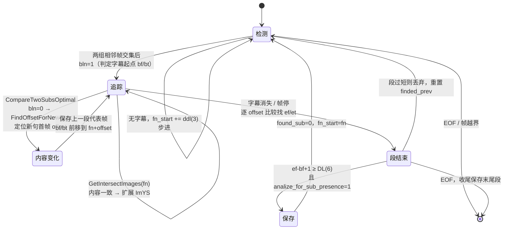

# subtitle_finder

吃视频 → 输出**字幕关键帧图 + 时间轴**。复刻 [VideoSubFinder](https://github.com/maki805/VideoSubFinder)
的「筛选」管线（传统 CV，不做 OCR），把 `rapidocr_ort` 作为下游识别器，对应官方
`VideoSubFinder → RapidVideOCR` 的分工。

> **本包只负责「找到字幕变化的关键帧 + 时间轴」，不做识别。**
> 设计细节、C++ 对齐经验、性能基准见 [`DESIGN.md`](./DESIGN.md) 与
> [`docs/cpp-alignment-notes.md`](./docs/cpp-alignment-notes.md)。
> ⚠️ 文档滞后时**以源码 `///` 注释为准**（`AGENTS.md` 约定）。

---

## 1. 定位：在整条字幕链路里的位置



对照官方：`VideoSubFinder`（找关键帧） ≈ 本包；`RapidVideOCR`（识别） ≈ `rapidocr_ort`。
相较「按 fps 抽帧再逐帧 OCR」，本包**逐帧（30fps）+ 只在字幕内容变化时输出关键帧**，
既无采样时间偏移，又大幅减少下游要 OCR 的帧数。

---

## 2. 内部分层架构



**两条正交链路**（`lib.rs` 是唯一对外出口）：
- **看/筛选**：`find_keyframes` → `state::run_state_machine` → 解码 + transform + 判定 → `Vec<Keyframe>`。
- **落盘**：`output::write_artifacts(kfs, mode)` 把 `Keyframe` 写成帧图 / 掩码 / timeline / json，
  CLI 与库调用方共用，文件名约定集中于此。

---

## 3. 单帧 transform 流水线（`imgops::get_transformed_image`）

状态机不直接吃原始帧，而是先由 transform worker 把每帧 BGR 转成一组图像产物
（`state.rs::FrameData`：`bgr` / `im`(ImTF) / `ne`(ImNE) / `y`(ILA 时间图) / `has_text`）。



> ③ 的 FF / NE / HE 在 C++ 里 `run_in_parallel`；本包提供 `SF_PARALLEL=1` 帧内并行
> 开关，但**默认关闭**——默认靠帧间并行（见 §5），帧内再切线程收益为负。
> 色彩链路刻意对齐 C++：解码用 OpenCV `VideoCapture`（bt709 BGR），YUV 用
> `cv::cvtColor`，避免早期 `ffmpeg-next`（bt601）造成的幽灵带 / 字幕段丢失。

---

## 4. 解码 + transform 的并行流水线（`state.rs::TransformStream`）



- 解码线程按 `idx % n_workers` 分发，N 个 worker 各自跑 §3 的 transform，
  输出经 reorder 缓冲**严格按帧号升序**供状态机消费（对齐 C++ `AddConvertImageTask` 前瞻）。
- `FrameCache` 只保留 `[fn-MAX_WINDOW, fn]` 的滑动窗口（约 20 帧），
  否则 170s / 5100 帧 ≈ 30GB 会 OOM。
- worker 数默认 `min(4, cpu/3)`，可用 `SF_NWORKERS` 覆盖。

---

## 5. 状态机时间轴（`FastSearchSubtitles`）

这是「时间无偏移」的关键，必须精确对齐 C++ `SSAlgorithms.cpp::FastSearchSubtitles`。



**核心参数**（`params.rs::Params::default()`，对齐 VideoSubFinder）：

| 参数 | 值 | 含义 |
| --- | --- | --- |
| `dl` | 6 | 滑动窗口长度（`ddl = dl/2 = 3` 步进） |
| `segh` | 3 | 水平条带高度 |
| `tp` / `mtpl` | 0.3 / 0.022 | 文字占比 / 最小文字长度 |
| `veple` / `ilaple` | 0.30 / 0.30 | 跨帧文字差异 / ILA 差异阈值 |
| `max_dl_down` / `max_dl_up` | 20 / 40 | 字幕最短 / 最长持续（帧） |

> 段尾 PTS 采用**旧句最后可见帧的真实 PTS**（`frame(fn+offset-1).pos`），
> 而 C++ 的 `PosForward[offset]-1` 会虚推约 1 帧。取舍见 `DESIGN.md`「段尾 PTS」一节。

---

## 6. 模块 ↔ C++ 对照速查

| 本包模块 | 复刻的 C++ / 职责 |
| --- | --- |
| `lib.rs` | 对外 API `find_keyframes` + `Keyframe{start_ms,end_ms,frame,mask}` |
| `frame.rs` | `VideoCapture` 逐帧解码（BGR，30fps），`FrameStepper` / `FramePipeline` |
| `imgops.rs` | `GetTransformedImage` / `IPAlgorithms.cpp` 基础像素算子（行优先一维 buffer） |
| `preprocess.rs` | `IntersectTwoImages`（相邻帧交集去噪）、`AnalyseImage`（水平投影检测文字） |
| `filter.rs` | `FilterTransformedImage` / `IPAlgorithms.cpp`：8 邻接 BFS 连通域 + Center 对齐 |
| `compare.rs` | `CompareTwoSubs(Optimal)` / `SSAlgorithms.cpp`：跨帧内容差异判定 |
| `state.rs` | `FastSearchSubtitles` 状态机 + `RunSearch` 环形缓冲 / `FrameCache` 流水线 |
| `params.rs` | 全局默认参数（见 §5 表） |
| `output.rs` | 落盘：`frames/` `mask/` `timeline.txt` `keyframes.json` |
| `main.rs` | CLI（`--profile` / `--output` / `--out`），仅参数与 UX |

算子复用：Sobel / 卷积 / SIMD 来自 `geometry::imgproc`；连通域为自写 BFS（替代
`CMyClosedFigure` / OpenCV `findContours`）；识别在下游 `rapidocr_ort`，**不在本包**。

---

## 7. 用法

```bash
# CLI（默认 full：帧图 + 掩码 + timeline + json，落到包内 out/）
cargo run -p subtitle_finder --release -- <video.mp4>
cargo run -p subtitle_finder --release -- --profile <video.mp4>       # 附分阶段性能剖析
cargo run -p subtitle_finder --release -- --output timeline <video.mp4> # 只写 timeline.txt
cargo run -p subtitle_finder --release -- --output frames <video.mp4>    # 仅原始关键帧 PNG

# 库方式
# let kfs = subtitle_finder::find_keyframes(&path, &Params::default())?;
# subtitle_finder::output::write_artifacts(&kfs, &out_dir, OutputMode::Full, ...)?;
```

文件名 `{start_ms}_{end_ms}.png` 即 `subtitle_ocr --dir` 的 `ms_ms` 时间区间约定，
`frames/` 目录可直接喂下游 OCR。
更多脚本见 [`justfile`](./justfile)，辅助工具见 `src/bin/`（`perfbench` / `ab_dump` / `extract_frame`）。
